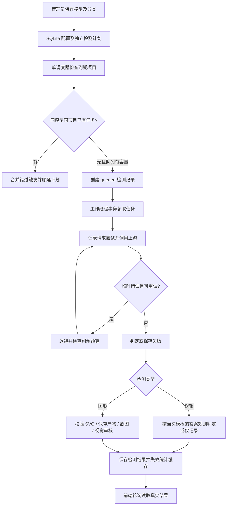

# LLM Dashboard 后端交互与前端展示说明

## 产品结构

公开页面按卡片展示，卡片包含多个子模型。卡片保存名称、自定义分类、共享 API 地址和 Key、公开状态、总开关与排序。子模型保存模型 ID、显示名称、请求参数、排序、独立开关和两项检测计划。一个模型配置只属于一个卡片。

分类名称完全自定义，去除首尾空白后按 casefold 判重；每张卡片最多选择一个分类，也可不选。分类通过稳定 ID 关联，重命名不改变归属，删除时外键将归属设为 NULL（未分类）。分类没有凭据、调度或汇总指标，首页仅显示包含公开非空卡片的分类及其卡片、模型数量。

隐藏仍可自动检测，暂停仍可公开历史。归档后从管理列表和公开页面移除，历史仍保留到保留期限，可由管理员查询。请求连接和参数在领取任务时取得；提示词与判定规则在入队时保存快照，不受后续模板修改影响。

## 执行流程



任务采用数据库中的有界队列，默认上限 32。`check_runs` 的部分唯一索引与短事务共同保证同一个模型、同一种检测不会同时生成多个待执行任务。运行期间跨过下一次时间时，不积压补跑。

调度默认每 2 秒检查到期项目；检测并发默认 2，管理员可在网页调整为 1–8，SVG 渲染另有限制为 1。并发调整无需重启，降低上限不打断运行中的任务，后续领取任务遵守新的上限。领取任务时重新检查启停、归档和凭据配置；暂停取消尚未发送的任务。管理员立即检测允许验证暂停配置，仍禁止同项重复排队。

重启将排队 / 运行中检测及未完成请求标记为中断，防止重放已经可能计费的请求。下一轮根据正常计划执行，前台打开与否不影响检测。

## 存储关系

| 表 | 内容 |
| --- | --- |
| `channels` | 内部一对一连接记录，保存地址、Key、公开、排序及归档；后台不暴露渠道层级 |
| `model_categories` | 自定义分类名称、唯一规范名称和排序 |
| `model_configs` | 子模型显示名称、调用参数与 position；channel_id 允许多个子模型，旧 category_id 不再作为归属来源 |
| `prompt_templates` | 自定义逻辑 / 图形模板、提示词、判定标准、修订版本和归档状态 |
| `check_schedules` | 每个模型的 candy / pelican 独立计划，以及所选 template_id |
| `check_runs` | 每轮检测状态、配置与模板快照、template_id / template_revision、题目、输出、判定和审核 |
| `request_attempts` | 主请求及审核请求的每次尝试、状态、耗时和 Token |
| `artifacts` | 图形生成时间、SVG / PNG 路径和缩略图状态 |
| `admin_auth` | 管理密码盐和哈希 |
| `app_settings` | 网页保存的检测并发、检测记录、图形与完整回答保留天数 |
| `schema_migrations` | 数据结构迁移版本 |

数据库为 `${DATA_DIR}/monitor.sqlite3`，使用 WAL、外键与连接等待超时。网络调用、重试等待和截图在事务外执行；流式片段不逐个写库。SVG / PNG 保存在 `${DATA_DIR}/artifacts/YYYY/MM/检测ID/`，使用临时文件和原子替换。

数据库存 UTC 时间戳，浏览器以 `Asia/Shanghai` 显示。配置快照不包含 Key 或完整 API 地址。

## 公共接口

所有公开接口只读，不向上游发起请求。隐藏或归档结果在摘要、历史、详情及产物读取路径均被过滤；已暂停的公开模型仍可读取。

| 方法与路径 | 参数 / 返回 |
| --- | --- |
| `GET /api/dashboard` | `hours=1/6/24`，默认 24；返回 cards（嵌套 models）、兼容平铺 models、categories 分类、指标、时间条和最近图形，以及独立于 hours 的近 24 小时逻辑概览 |
| `GET /api/channels/{id}/history` | `kind=candy/pelican` 可选，`limit=1..100` 默认 50，`before=检测ID` 可选 |
| `GET /api/models/{id}/runs` | 同上，按模型过滤 |
| `GET /api/runs/{id}` | 单次检测、配置摘要、回答、判定、请求尝试及产物信息 |
| `GET /api/runs/{id}/svg` | 新图形或安全校验后的旧版 SVG；不存在 / 不公开为 404 |
| `GET /api/artifacts/{id}/thumbnail` | 静态 PNG，未生成 / 不公开为 404 |
| `GET /api/artifacts/{id}/svg` | 安全校验后的 SVG，未生成 / 不公开为 404 |
| `GET /api/auth/status` | `configured` / `setup_allowed`，及当前请求的 `authenticated`、`expires_at`（未认证为 null） |

历史采用 ID 倒序游标，返回 `items` 和 `next_before`。下一页将 `next_before` 作为 `before`，不要对已经读取的条目重复追加。图形摘要按生成时间排列。

旧 `/api/guest/*` 提交、进度和读取接口统一返回 410，说明访客检测已关闭。公开详情不返回密钥或完整连接地址；来自旧数据的字符串同样需要脱敏。

大盘返回结构要点：

```json
{
  "server_time": 1791676800,
  "window_hours": 24,
  "timeline_hours": 6,
  "refresh_seconds": 15,
  "overview_start": 1791590400,
  "overview_end": 1791676800,
  "categories": [{"id": 1, "name": "自定义系列", "sort_order": 0, "model_count": 1}],
  "models": [{
    "id": 1,
    "title": "主模型",
    "name": "主模型",
    "model": "actual-model-id",
    "category_id": 1,
    "enabled": true,
    "logic_24h": {"passed": 18, "wrong": 2, "graded": 20, "ungraded": 1, "rate": 90, "template_count": 1, "updated": 1791676700},
    "metrics": {
      "attempts": 12,
      "successful": 11,
      "success_rate": 91.6667,
      "first_token_seconds": 7.2,
      "timing_samples": 11,
      "cache_rate": 80,
      "cache_samples": 10,
      "cache_coverage": 83.3333
    },
    "timeline": {"start": 1791655800, "end": 1791677400, "step_seconds": 600, "buckets": []},
    "schedules": [],
    "runs": [],
    "images": []
  }]
}
```

以上数值只说明字段，不是演示数据来源。`null` 表示未知或没有有效样本。模型包含其检测计划、最近每类最多 50 轮、逻辑通过 / 答错 / 无效 / 未完成数量及模型级指标；图片条目包含 `run_id`、生成时间、所属模型、渲染状态和缩略图可用性。旧图片的产物 ID 可能为空，使用检测 ID 对应的 SVG 路径。

## 管理接口和配置示例

浏览器管理员登录后，后端设置 `llm_dashboard_admin_session` 会话 Cookie：`Path=/`、`HttpOnly`、`SameSite=Lax`、`Max-Age=7200`，不设置 Domain。直接 HTTPS 连接还设置 `Secure`；HTTP 局域网部署仍可使用，未受信任的 `X-Forwarded-Proto` / `Forwarded` 请求头不会将 HTTP 视为 HTTPS。

前端不把令牌保存为内存登录状态、localStorage 或 sessionStorage，而是在初始化时读取 `/api/auth/status` 并使用同站请求的 Cookie。在同一浏览器、同一主机下，刷新、返回首页和重新进入后台都能恢复未过期登录；IP 与 localhost 是不同 Cookie 主机。Cookie 本身不按 TCP 端口隔离。

会话有效期为两小时，服务重启或修改管理密码使所有内存会话失效；密码哈希继续保留，会话不写入数据库。API 客户端仍可使用登录返回的令牌，通过 `Authorization: Bearer <token>` 认证。显式 Authorization 优先，即使同时存在有效 Cookie，错误或过期的 Bearer 也不会回退为 Cookie 登录。

写请求使用 `Content-Type: application/json`；不接受跨站 Origin，也拒绝明确的 `Sec-Fetch-Site: cross-site`。无 Origin 的普通 API 客户端仍可使用 Bearer。退出是幂等操作：撤销 Cookie 及显式令牌对应的会话，清除浏览器 Cookie；已经过期或没有会话也可正常退出。

| 方法与路径 | 用途 |
| --- | --- |
| `POST /api/auth/setup` | 未初始化时网页首次设置密码，JSON `{ "password": "..." }`，12–256 字符；已初始化时不可再次设置 |
| `POST /api/auth/login` | `{ "password": "..." }`，设置会话 Cookie，返回 `token`、`expires_at`、`expires_in=7200` |
| `POST /api/auth/logout` | JSON `{}`，幂等撤销会话并清 Cookie，无需仍有有效会话 |
| `GET /api/admin/settings` | 读取检测并发和三类数据保留天数 |
| `PATCH /api/admin/settings` | 修改 `worker_concurrency`、`run_retention_days`、`artifact_retention_days`、`output_retention_days` |
| `POST /api/admin/password` | `{ "current_password": "...", "new_password": "..." }`；验证当前密码后修改，撤销全部会话并清 Cookie |
| `GET /api/admin/cards` | 返回 `{cards, categories, templates}`，cards 嵌套子模型、计划和任务；凭据仅返回脱敏值 |
| `POST /api/admin/cards` | 创建共享卡片，支持内联新分类，HTTP 201 |
| `PATCH /api/admin/cards/{id}` | 修改卡片共享连接、分类、公开、排序、总开关、归档 |
| `POST /api/admin/cards/{id}/models` | 添加子模型，或 copy_from 同一卡片模型；新增和复制默认暂停，HTTP 201 |
| `GET /api/admin/models` | 返回 `{models, categories, templates}`；连接信息只提供脱敏值 |
| `POST /api/admin/models` | 一次创建模型、私有连接与检测计划，返回 ID，HTTP 201 |
| `PATCH /api/admin/models/{id}` | 仅编辑子模型参数、position、启停、归档及 schedules；拒绝连接、分类与公开字段 |
| `GET /api/admin/categories` | 分类列表及管理端模型数量 |
| `POST /api/admin/categories` | `{name, sort_order}` 新增分类 |
| `PATCH /api/admin/categories/{id}` | 重命名或排序 |
| `DELETE /api/admin/categories/{id}` | JSON `{}`，卡片移至未分类、保留历史 |
| `GET /api/admin/templates` | 未归档模板列表，包含修订版本及引用模型数量 |
| `POST /api/admin/templates` | 新增提示词模板，返回 ID，HTTP 201 |
| `PATCH /api/admin/templates/{id}` | 编辑模板并递增版本；检测类型不能修改 |
| `DELETE /api/admin/templates/{id}` | JSON `{}`，归档未被现有模型引用的模板，保留历史 |
| `POST /api/admin/models/{id}/run` | `{ "kinds": ["candy", "pelican"] }`，返回任务 ID，HTTP 202 |
| `GET /api/admin/tasks` | 当前排队 / 运行中任务 |
| `GET /api/admin/runs/{id}` | 管理员查看检测详情，包括未公开历史 |

空数据库允许通过 `/admin` 首次设置密码，初始化与登录不要求已有会话；其他管理接口始终要求管理员登录。网页初始化与修改密码均要求再次输入密码确认。密码使用加盐哈希保存，修改时新密码为 12–256 字符，成功后需重新登录。

“系统设置”保存到 SQLite，默认 `worker_concurrency=2`、`run_retention_days=90`、`artifact_retention_days=30`、`output_retention_days=30`。并发校验为整数 1–8，保留天数为整数 1–3650；设置更新无需重启容器。保留期限由下一轮每小时例行清理使用，回答和图形的实际期限不超过检测记录期限，运行中任务不清理。

管理页面调用 cards 接口和子模型接口。旧渠道接口保留；旧 POST /api/admin/models 作为兼容入口仍创建一张单模型卡片，GET 返回平铺集合。大盘 cards 的 ID 是 channels.id，子模型 ID 是 model_configs.id；新增第二个模型不会复制连接。公开 GET /api/cards/{id}/history?kind=pelican 返回卡片所有子模型图形记录，支持 before 翻页和来源标识。

模型新增 / 编辑示例：

```json
{
  "display_name": "模型 A · 高思考",
  "base_url": "https://api.example.com/v1",
  "api_key": "填写真实密钥",
  "category_id": null,
  "public": true,
  "sort_order": 0,
  "model": "actual-model-id",
  "protocol": "responses",
  "effort": "high",
  "retry_count": 2,
  "timeout_seconds": 300,
  "first_token_timeout": 120,
  "idle_timeout": 60,
  "max_output_tokens": 16000,
  "enabled": true,
  "schedules": {
    "candy": {"enabled": true, "interval_minutes": 10, "template_id": 1},
    "pelican": {"enabled": true, "interval_minutes": 45, "template_id": 2}
  }
}
```

模型 Key 留空保留原值，地址留空也保留原值。更换地址必须重新提交对应 Key。响应只提供脱敏地址和 Key，不回填完整秘密。`archived: true` 归档；当前不提供回收站恢复流程。

手动检测不传 `kinds` 时使用该模型已经开启的项目；空列表、重复项目、未知项目、错误类型均返回 400，不增加请求。已有同项排队 / 运行任务时返回 400，不重复提交。

新增模型默认暂停，默认开启逻辑检测（10 分钟）、关闭图形检测（45 分钟）。可用 `category_name` 替代 `category_id` 在同一事务中创建分类。保存包含连接、模型、分类及计划，任何校验失败都会完整回退。

新增时可传 `copy_from: 模型ID` 复制配置，未覆盖的参数、分类、计划和凭据由服务端复制，凭据不经过浏览器。副本默认暂停、不复制历史，修改密钥互不影响。更换地址时仍必须提供新密钥；归档的模型不能作为复制来源。

校验范围：卡片名称和模型标识 1–120 字符；分类名称 1–60；协议 `responses` / `chat`；思考强度 `low` / `medium` / `high` / `xhigh`；重试 0–5；整项检测预算 10–600 秒；首次内容等待 5–600 秒；读取空闲 5–300 秒；输出上限 1024–64000 Token；检测间隔 1–1440 分钟。

### 模板字段与版本

模板字段为 `name`（1–100 字符）、`kind`（`candy` 逻辑 / `pelican` 图形）、`body`（1–12000 字符）、`rule_type`、`expected_answer`、`review_criteria`、`require_animation`（布尔值）。逻辑 `rule_type` 可选 `number` / `exact` / `contains` / `none`；除 `none` 外答案必填，最多 500 字符，`number` 限整数或小数字面量。图形使用 `visual`，审核标准 1–4000 字符。模板请求 JSON 最大 65536 字节，其他写请求仍为 16384 字节。

`number` 沿用默认题的独立数字边界匹配，不做数字等价或语义评分；`exact` 对完整回答和答案做 NFKC、casefold 和空白规范化后比较；`contains` 区分大小写；`none` 返回 `ungraded`，不计正确率。图形提示词仅按字面替换 `{scene}` 和 `{nonce}`，保留普通 CSS 大括号；附加安全 SVG、可见校验码和可选动画要求。取消动画要求时不检查动画声明，仍校验 SVG 安全与校验码。视觉审核使用模板标准和四帧截图，要求返回 `checks.requirements`（true / false / null），模板审核版本为 2；无模板旧任务仍支持原四项鹈鹕审核。

检测计划只能选择同类型、未归档模板；启用检测必须有模板，关闭项目可将 `template_id` 设为 null。省略选择时新增计划自动选择默认模板或该类型首个可用模板。复制模型保留模板选择。模板本身不保存模型、密钥或调度间隔。

修改实际字段时模板 revision 递增，重复保存不递增。创建检测时将模板内容及标准存入 `check_runs.config.prompt_template`，并记录 ID、revision、渲染后的 prompt 与规则版本 `template-{id}-v{revision}-{rule_type}`。领取任务重新读取连接参数时保留模板快照。修改、重新选择或归档模板不改变排队和历史检测的题目与评分；已有非归档模型引用模板时拒绝归档。公开详情中的 `template` 为当次名称、版本及判定标准，完整题目使用 `prompt` 字段。

`timeout_seconds` 是整项检测共享预算，覆盖生成、重试与退避、渲染锁等待、截图及审核；渲染阶段至多 30 秒，审核请求至多 120 秒，均受剩余预算约束。真正使用的首次等待也不超过剩余预算。上游仍可能不支持某些模型参数，检测详情会显示相应失败。

返回状态：401 未认证；400 配置 / 参数无效；403 不允许的首次设置或跨站写入；404 结果不存在 / 不公开；410 已关闭的访客接口；415 非 JSON；500 服务异常。

## 请求计时与统计

`first_token_seconds` 从实际发送请求开始计时，到第一段非空有效内容结束。角色标记、心跳、响应创建事件不计入；明确返回的推理内容可计入。队列等待不计入上游耗时。非流式 JSON 不提供该指标。

建连、TLS 和等待 HTTP 响应头的 socket 等待预算取配置首返期限与剩余总期限的较小值，不硬编码为 20 秒；请求准备时间也从预算中扣除。收到响应头后再检查单调时钟期限，等待正文不能重新获得完整预算。流式首段有效内容到达前还受首返期限限制；所有读取受剩余总预算和读取空闲期限限制。标准库 DNS 解析仍受系统解析器影响，因此 socket 超时不等同于能强制中断所有解析步骤。

成功主请求包括最终有效、完整的 API 返回，即使内容答错；没有结束事件的流式响应不算成功。每次重试单独落库。`role=review` 为视觉审核请求，详情可见，但不参与模型卡片统计。

| 项目 | 约定 |
| --- | --- |
| 缓存 | 有效缓存 Token 加权比率，不是各请求缓存百分比的平均值；字段缺失不同于明确为 0 |
| 覆盖率 | 有有效缓存数据的请求数 / 统计中的已结束请求数 |
| 成功率 | 成功主请求尝试 / 已结束主请求尝试，重试前失败保留；已发送后中断计失败，运行中不计分母，未发送即取消没有请求样本 |
| 首次返回 | 成功主请求中有效计时样本的平均值，提供样本数 |
| 概览逻辑通过率 | 完成时间在近 24 小时内的全部逻辑检测，通过 / 通过加答错；请求失败、未评分、图形不计入分母 |
| 卡片逻辑正确率 | 最近 50 轮有效判定中通过 / 通过加答错，请求失败和未评分单独显示 |
| 卡片请求统计窗口 | 1 / 6 / 24 小时，默认 24，同一卡片全部未归档子模型主请求汇总；不改变逻辑概览 |
| 模型请求时间轴 | 最近 6 小时，36 个十分钟格，包含当前尚未结束的时间段 |
| 逻辑历史 | 最近 50 轮，每格一轮，独立于时间轴分桶 |

速度档位 `<10s` / `10–<30s` / `30–<50s` / `≥50s` 分别为绿黄橙红；没有可测量样本为灰。可用性格是全部成功、混合或全部失败，有运行请求时附加状态。网络超时不替代为速度档位数值。

旧逻辑规则版本 `candy-v1-independent-21` 与默认糖果模板均不做语义评分，新检测使用所选模板的版本化规则。`logic_24h.template_count` 统计已评分记录中不同模板 ID / revision 数量，无模板旧记录视为一个旧版规则；不同题目的模型不作为统一排名。图形使用结构检查与版本化多帧审核；需要支持图片的同模型调用。审核不可判断、格式错误或渲染失败保留单独原因；安全 SVG 可以继续展示，恶意资源引用不展示。

## 前端展示与交互

顶部使用紧凑横栏展示全站滚动 24 小时概览，数据来自 `overview_24h`，不随分类筛选、卡片请求时间窗口或最近 50 轮限制改变。仅包含公开且未归档的模型及逻辑检测：

- `participating_models`：窗口内有创建、开始或完成记录的模型数量；`monitoring_models`：当前模型、卡片与逻辑计划均启用的模型数。
- `completed`：完成时间落在窗口内的已结束轮数；重试按一轮计算，排队及运行中不计入。
- `anomalies = wrong + failed`：最终校验未通过与请求失败。通过、未评分、中断、取消和其他历史结果在折叠明细中分别显示，全部类别相加等于累计检测。
- 全部为空时显示 0；旧接口缺少该统计字段时显示“—”，不把缺失数据当作 0。异常数大于 0 时强调显示，移动端三项纵向排列。


以用户截图为布局依据：浅灰背景、白色细边框卡片；宽屏双列、小屏单列。首页标题为“模型健康监控”，副标题为“接口是否稳定，回答是否准确，图形是否符合预期。”，旁边保留刷新图标。下方概览展示近 24 小时各模型通过率、通过数 / 已评分数及未评分数；说明、统计范围、同步时间与卡片请求窗口折叠在“统计说明与更新时间”。分类按钮同时筛选概览和卡片，不按相同模型 ID 合并不同配置。

卡片顺序：标题与运行状态 → 三列指标 → 请求可用性条 → 首次返回速度条 → 各子模型独立逻辑检测区 → 全部子模型图形测试缩略图。

“逻辑题表现”区域展示显示名称、正确率、检测中 / 下次时间、最近 50 轮红绿条、通过和答错数量。颜色附带文本与图例；鼠标与键盘均可打开单次详情，不只依赖颜色区分结果。每个模型提供“查看逻辑记录”入口，记录列表使用大点击区域，适合手机；从详情返回时恢复原分页、滚动位置和所选记录。

逻辑详情底部固定显示左右切换按钮及“窗口内 X / N 轮”：左侧查看更早一轮，右侧查看更新一轮，首尾禁用对应按钮，不循环。首页入口使用打开时该模型最近最多 50 轮，历史列表入口使用该页逻辑记录；仅计实际记录，包含失败和进行中的轮次。浏览期间固定记录 ID 和顺序，首页刷新不改变窗口；进行中的当前轮次仍自动更新。切换时内容回到顶部，保留底部导航和键盘操作，忽略过期请求；加载失败仍可切换或重新读取。关闭后重新打开获取新窗口。

图形区合并展示本卡片全部子模型最近 50 张产物，缩略图下标注北京时间和模型名称，支持横向滚动。分类与卡片汇总按卡片 ID，逻辑记录按子模型 ID；图形历史按卡片翻页，详情保留当次模型快照。静态缩略图延迟加载，打开详情后再加载 SVG 动画。缺缩略图时用占位，不阻塞其他卡片。

桌面鼠标停留缩略图 250 毫秒后显示约 360 像素宽的原始 SVG 动画预览，优先在上方显示并避开屏幕边缘；移入浮层继续显示，离开 150 毫秒后关闭。键盘聚焦也可预览，触摸设备直接点击打开详情。图形列表提供左右翻页和“回到最新”；详情支持方向键和图片左右滑动切换。

详情弹窗展示检测时间、卡片名称、模型、协议、思考强度、回答 / 图形、请求耗时和重试、规则判定和审核结果。点击遮罩、Esc 或关闭按钮均可关闭；开始与结束都在遮罩上的点击才触发关闭，拖选弹窗内的内容不会误关。打开期间锁定背景滚动，关闭后恢复浏览位置与焦点。长弹窗的标题与关闭按钮保持可见，管理员表单的取消与保存区也保持可见。

管理员表单没有修改时直接关闭；修改后关闭则提示“放弃修改 / 继续编辑”，确认提示的 Esc 或遮罩操作默认继续编辑。模型、分类及模板表单均遵守此约定。保存中锁定表单与关闭操作，失败保留输入。重试、超时和输出限制放入高级设置，关闭检测项目时关联间隔输入禁用；每个项目提供模板选择和展开预览。模板管理支持新增、编辑、复制、归档，编辑时保留类型。保存、启停和排队提供浮动反馈。管理员可以另从受保护接口读取未公开详情。

页面默认 15 秒刷新，隐藏时减少轮询，恢复可见时更新。不重叠发送同类摘要请求，通过局部更新保留已有卡片和图片节点，并恢复必要的焦点，不在刷新时抢回用户的横向滚动、筛选、展开状态或弹窗。正在检测的详情每 3 秒读取进度，完成后停止；页面隐藏时降低频率，关闭或切换详情后忽略旧请求。没有数据、暂停、排队、检测失败分别显示；倒计时仅预测计划时间，资源等待可能使实际启动稍晚。

平均首次返回使用与速度条相同的颜色档位，缺失值为灰；逻辑正确率仅全部通过时使用绿色，其他数值保持中性色。图形详情区分生成失败、预览处理失败、审核失败及审核未通过，不将视觉审核结果等同于模型请求失败。

## 当前边界

当前未引入 Redis、WebSocket、外部消息队列或多个调度实例；也没有实现通知告警、多管理员账号、独立审核模型、完整题库评分或 PostgreSQL。管理员凭据是数据库中的明文 API Key，文件权限保护不等于加密。后续扩展应基于真实容量和检测需求，不改变已保存历史的统计口径。

## 版本 3 迁移与验证

迁移保留 model_configs、check_runs、request_attempts、artifacts、check_schedules 的 ID。为原来同渠道的每个模型复制独立连接，按 model_id 更新检测与请求的 channel_id；已有快照、结果、图形关联和计划时间不变。单模型沿用卡片标题，多模型使用原标题与模型显示名称组成卡片名称。模型初始 category_id 为 NULL，既有公开/暂停/归档状态保留，管理密码不变。

连接唯一索引、版本标记与迁移在同一事务中提交。旧 channels 表名保留用于历史外键，产品不再要求用户先创建渠道。升级前备份数据库与产物；回退需匹配旧镜像和升级前数据库。启动恢复流程仍将中断任务标记为 interrupted，不重复发送可能已计费的请求。

验证包括共享连接拆分和重复启动、保存失败回退、分类更名/删除保留历史、同名模型统计与最近 50 张图片独立、隐藏/归档的所有读取路径、凭据复制与轮换、页面筛选及刷新焦点、移动端长名称、登录刷新恢复和弹窗关闭保护。

## 版本 4 迁移与验证

迁移在同一事务内添加计划模板关联、检测模板 ID / revision，创建默认糖果和鹈鹕模板，并将现有计划关联到对应类型。旧记录的题目、规则、输出、判定和配置快照保持原值，模板 ID 留空；不会重新评分。模型、连接、密码、分类、各表旧字段和检测间隔保持不变。模板关联与近 24 小时逻辑统计有索引，重复启动不重复新增默认模板。

新增验证覆盖模板类型校验、引用归档保护、复制保留选择、排队快照与历史不变、四种答案规则、无动画图形、自定义视觉标准、超过 50 条记录的完整 24 小时统计、旧数据库重复迁移，以及真实管理接口与浏览器中的模板创建 / 选择 / 修改版本、概览和手机布局。

## 版本 5 多模型卡片

解除 model_private_connection 唯一索引，新增 channels.category_id 和 model_configs.position；不 UPDATE 旧行归属、不复制或合并旧连接、不搬移历史、不清空数据。旧卡片默认未分类；管理员可自行重新配置。历史版本 3/4 的迁移仅用于那些旧版本数据库，已经升级的数据库不重跑。

总开关和子模型 enabled 分别保存，effective_enabled 为两者与计划开关的交集。暂停整卡取消 queued，running 正常完成；恢复只调度启用子模型。空卡片不进入公开页面。新建 / 复制子模型默认暂停，只复制参数、模板和计划，不复制历史，不允许跨卡片 copy_from。

卡片缓存率按有效样本 cached_tokens / input_tokens 汇总；请求成功率按成功主请求 / 已结束主请求汇总；首次有效返回按成功且有计时的请求样本汇总。归档子模型不再参与公开汇总。逻辑最近 50 轮与近 24 小时通过率始终各模型独立；24 小时概览标注卡片 / 模型。

验证覆盖三个以上子模型同卡展示、共用凭据轮换、整卡 / 单模型暂停隔离、原始请求加权汇总、每模型 50 轮逻辑、合并 50 张图形与历史翻页、跨模型图形导航、同模型逻辑导航、空卡片隐藏、无数据重组、桌面 / 手机布局以及表单未保存保护。

## 展示卡片精简（2026-10-11）

采用已确认的“保留双时间条”方案：请求可用性与首次返回速度保持展开，三项核心指标保留，样本计数与解释移至统计详情。各子模型仅显示名称、正确率、模板简称、检测状态、最近 50 轮色条，最近 50 轮口径只在区域标题显示一次；模型名称打开配置与计数详情，可进入最近结果或逻辑历史。历史 API 和统计口径不变。

图形区去掉说明、独立历史入口、左右及回到最新按钮、重复时间范围，仅保留模型署名的缩略图与拖动条。原生 range 与横向滚动位置双向同步，无溢出时隐藏；滑动、拖动、滚轮均可浏览。图形区域聚焦时左右键平移，缩略图聚焦时左右键在本卡片内移动焦点并自动滚入可见区域，边界不跨卡片；Enter 打开详情，关闭恢复焦点。详情内原有左右切换不变。自动刷新保留浏览位置与焦点。

展示卡片后续微调：模型名称、模板简称、正确率与下一轮状态同一行显示，窄屏通过省略长名称保持布局，完整名称在标题提示和模型详情中可查看。图形拖动条统一为浅灰蓝色细轨道与圆角滑块，保留原拖动、键盘及触屏操作。

模型摘要继续优化：桌面将正确率与下一轮时间放在卡片中部，模型名称和模板保留在左侧，右侧增加“最近结果”入口。百分比固定占位，倒计时使用等宽数字与固定列宽，秒/小时格式或调度状态变化均不会挤动正确率。窄卡片自动重排，中部仍在同一行显示正确率和时间；无逻辑结果时最近结果按钮禁用。

图形悬浮预览同时最多加载一张原始 SVG，缩略图保持静态；移开、关闭、打开详情、切换页面可见性或目标移出缩略图横向窗口时移除动画。加载失败恢复静态缩略图；系统启用减少动态效果时悬浮显示静态预览，仍可点击打开详情。手机保持点击详情播放，不在滚动列表中自动加载动画。
